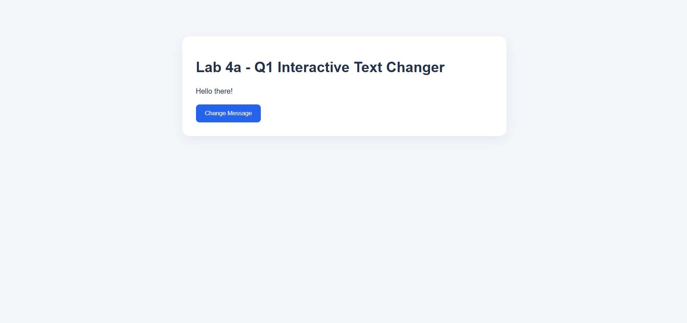
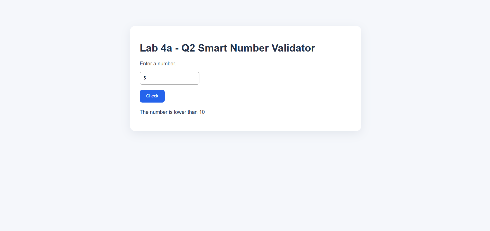

# BIC21203 Web Development — Lab 4a

## Client-Side Scripting (JavaScript)

**Student:** Khong Jia Yi  
**Student ID:** AI240176  
**Course:** BIC21203 Web Development  
**Academic Session:** 2026/2027

## Description

This lab focuses on client-side scripting using JavaScript. It covers functions, event listeners, conditional statements, loops and DOM manipulation.

## How to Run

1. Download or clone this repository.
2. Open the project folder in Visual Studio Code.
3. Install the Live Server extension by Ritwick Dey.
4. Open the Q1, Q2 or Q3 folder.
5. Right-click `index.html` and select **Open with Live Server**.
6. Test each question in the browser.

## Tasks

### Question 1 — Interactive Text Changer

- Display the original message: "Welcome to my website!"
- Change the paragraph to "Hello there!" when the button is clicked.
- Use `getElementById()`, `textContent` and `addEventListener()`.

### Question 2 — Smart Number Validator

- Accept a number from the user.
- Compare the number with 10 using `if...else if...else`.
- Display whether the number is lower than, higher than or equal to 10.
- Display an error message for empty or invalid input.

### Question 3 — Dynamic Number Generator

- Generate numbers from 1 to 5 using a `for` loop.
- Create list items using `document.createElement()`.
- Add items using `appendChild()`.
- Clear existing items to prevent duplication.

## Test Evidence

The following screenshots demonstrate the execution of all three questions. Add screenshots at the paths below before submission.

### Question 1 — Interactive Text Changer

### Question 2 — Smart Number Validator

### Question 3 — Dynamic Number Generator

## Conclusion

This lab helped me understand how JavaScript can make webpages interactive. I learned how to use functions, events, conditions, loops and DOM methods to update webpage content.
